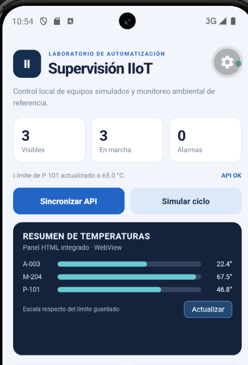
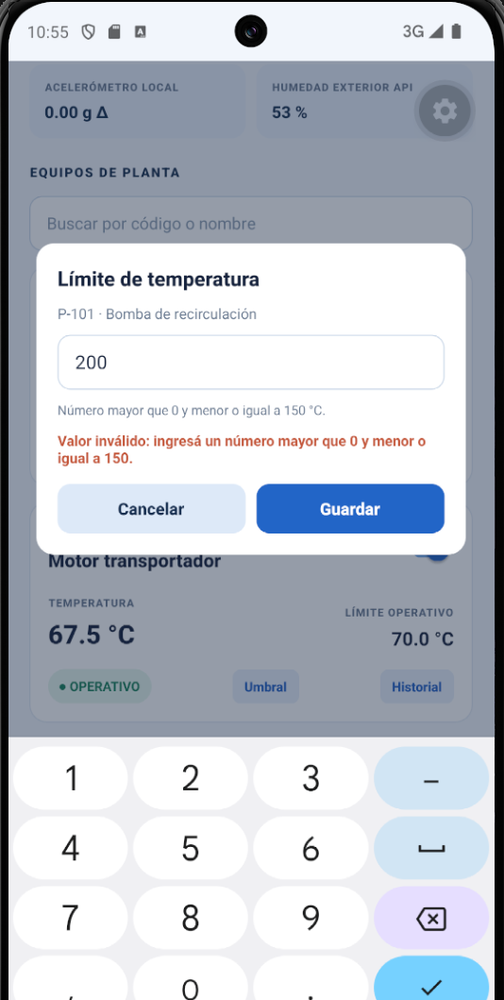
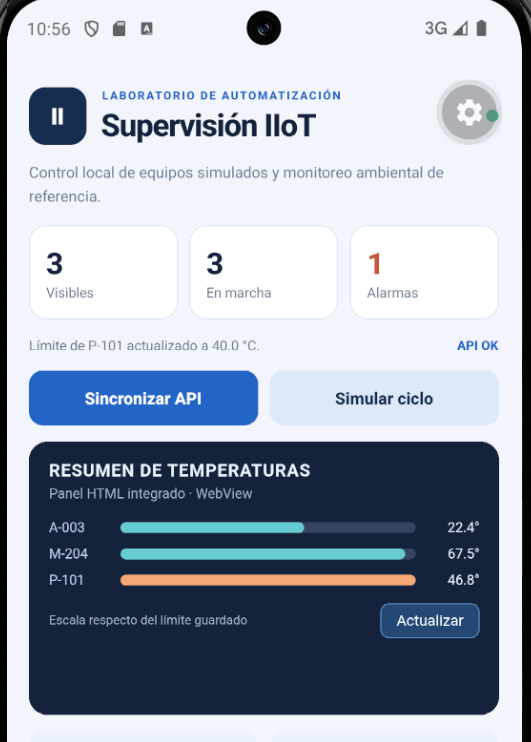
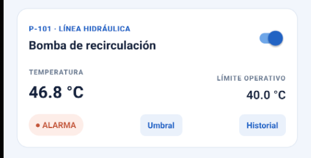
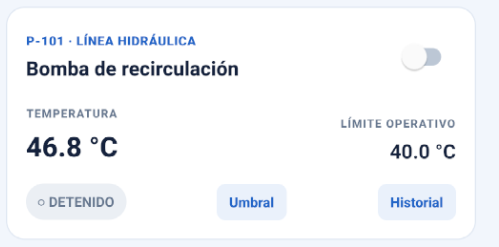
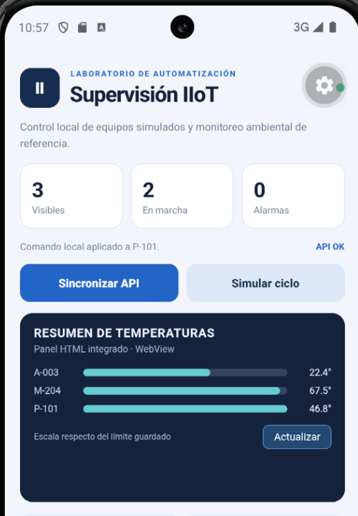
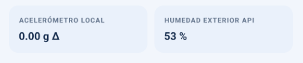
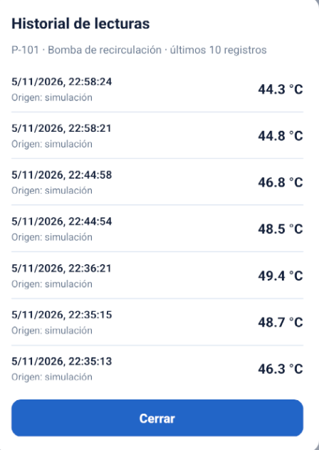
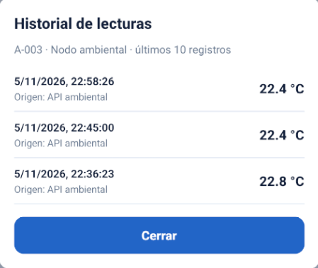

# Cambios y validación

## Funcionalidad 1 — Umbral

- Cambios realizados:
  - `src/domain/rules.ts`: `parseThreshold(texto)` valida el dato (acepta coma o punto; número real > 0 y <= 150). Si no es válido devuelve `null`.
  - `src/data/localDb.ts`: `saveMaxTemp(id, maxTemp)` persiste el límite en SQLite con una consulta parametrizada.
  - `src/viewmodel/usePlantViewModel.ts`: `changeMaxTemp(id, texto)` valida, guarda y actualiza el estado de la lista. Si el dato es inválido no guarda y devuelve el mensaje de error.
  - `src/components/ThresholdModal.tsx`: formulario (Modal) asociado al equipo seleccionado, con el límite actual precargado y el error visible. Se usa `Modal` y no `Alert.prompt` porque este último solo existe en iOS.
  - `src/views/PlantScreen.tsx`: el botón **Umbral** abre el formulario del equipo de esa tarjeta.
  - Al actualizarse `items`, se recalcula la alarma de la tarjeta, el contador de alarmas y el panel HTML (la WebView se regenera porque depende de `items`).
- Verificación:
  - Probé valores inválidos (`200` y `abc`): no se guardan y aparece el error en el formulario.
  - Con un límite menor a la temperatura (P-101 en 40) la tarjeta pasa a **ALARMA**, sube el contador y la barra del panel HTML se pone naranja.
  - Apagando el equipo con el switch la alarma desaparece.
  - Recargué la app y el límite nuevo se mantiene.

## Funcionalidad 2 — Historial

- Cambios realizados:
  - `src/data/localDb.ts`: `getLastReadings(id)` lee los últimos 10 registros del equipo (`WHERE equipment_id = ? ORDER BY id DESC LIMIT 10`), del más nuevo al más antiguo.
  - `src/viewmodel/usePlantViewModel.ts`: `loadHistory(id)` carga el historial en el estado (`history`, `historyLoading`) y maneja el error.
  - `src/components/HistoryModal.tsx`: muestra fecha/hora, temperatura y origen de cada lectura, con estado vacío ("Todavía no hay lecturas registradas…").
  - `src/views/PlantScreen.tsx`: el botón **Historial** abre el historial del equipo de esa tarjeta.
  - Las lecturas ya se guardaban en la tabla `readings` desde `recordReading`, que usan tanto **Simular ciclo** (origen "simulación") como **Sincronizar API** (origen "API ambiental").
- Verificación:
  - Antes de sincronizar, el historial de A-003 muestra el estado vacío.
  - Después de simular y sincronizar, P-101 muestra lecturas de origen "simulación" y A-003 de origen "API ambiental", de la más nueva a la más vieja.
  - Recargué la app y el historial se conserva.

## Refactorización A — SQL injection en la búsqueda

- Problema: en `src/data/localDb.ts`, `findEquipment` armaba el SQL concatenando el texto del buscador (`LIKE '%${filter}%'`). Un texto como `' OR 1=1 --` modifica la consulta (inyección SQL) y una comilla simple sola rompía la búsqueda.
- Solución: se pasó a consulta parametrizada (`WHERE name LIKE ? OR id LIKE ?` con el patrón `%texto%` como parámetro). El motor trata el valor como dato y no como parte del SQL. Sin filtro se usa una consulta fija.
- Evidencia: la búsqueda sigue funcionando igual que antes: escribiendo `p-1` filtra solo P-101 (captura `capturas/09-busqueda.png`) y con el campo vacío se listan los tres equipos.

## Refactorización B — Regla de alarma duplicada e inconsistente

- Problema: la condición de alarma estaba copiada en tres lugares (`EquipmentCard` y el contador en `src/views/PlantScreen.tsx`, y el panel en `src/components/OverviewWeb.tsx`). La copia del panel HTML no tenía en cuenta si el equipo estaba activado: marcaba en naranja equipos **detenidos**, contradiciendo la regla (alarma solo si está activado y `temperatura >= límite`).
- Solución: se centralizó la regla en una única función pura `isInAlarm()` en `src/domain/rules.ts` y se usa en los tres lugares. A la WebView se le pasa el campo `alarm` ya calculado, en vez de repetir la lógica dentro del HTML.
- Evidencia: con equipos activados el comportamiento es el mismo que antes. Apagando un equipo que supera su límite, ahora la tarjeta, el contador y el panel HTML coinciden (ninguno marca alarma).

## Evidencia de los flujos (capturas)

Capturas tomadas en el emulador Android (Pixel 8, API 34), en la carpeta `capturas/`.

### Flujo umbral + alarma

| # | Paso | Captura |
|---|---|---|
| 0 | Estado inicial: P-101 con límite 65 °C, sin alarmas |  |
| 1 | Umbral inválido (`200`): no se guarda y se informa el error |  |
| 2 | Umbral válido (`40`) menor que la temperatura: contador en 1 y barra naranja en el panel HTML |  |
| 3 | Tarjeta de P-101 en ALARMA con el límite nuevo |  |
| 4 | P-101 apagado: queda DETENIDO aunque supere el límite |  |
| 5 | Panel y contador sin alarma con el equipo apagado |  |

### Flujo simulación/sincronización + historial

| # | Paso | Captura |
|---|---|---|
| 6a | Sincronizar API: referencia recibida por HTTP y guardada |  |
| 6b | Humedad exterior obtenida de la API |  |
| 7 | Historial de P-101: lecturas de "Simular ciclo", de la más nueva a la más vieja |  |
| 8 | Historial de A-003: lecturas de "Sincronizar API" |  |
